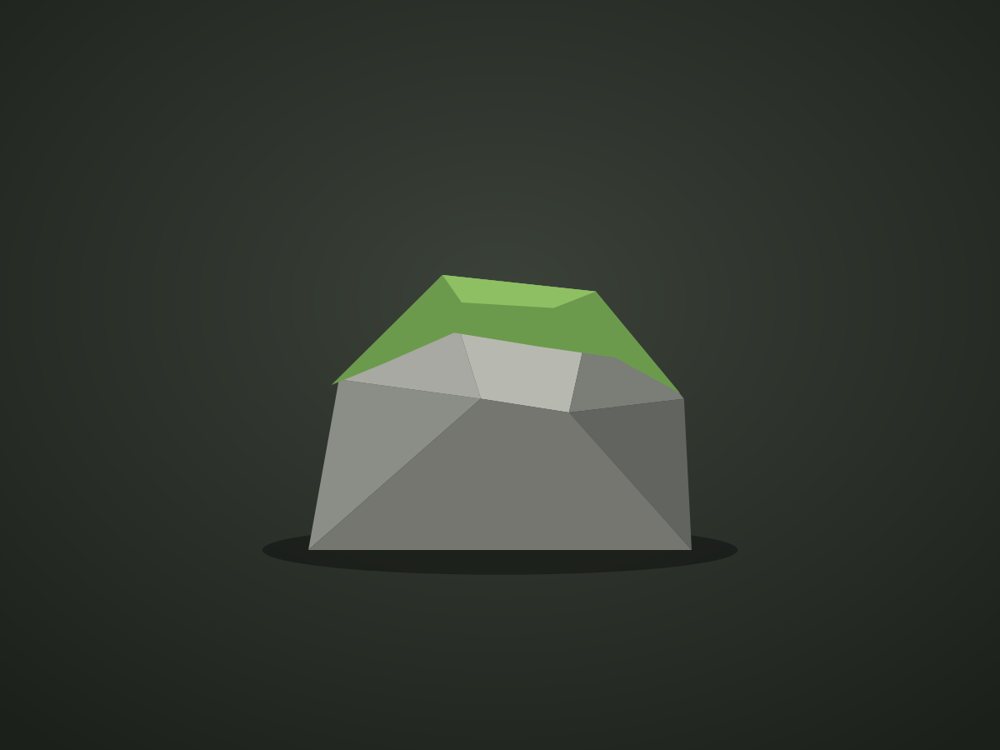
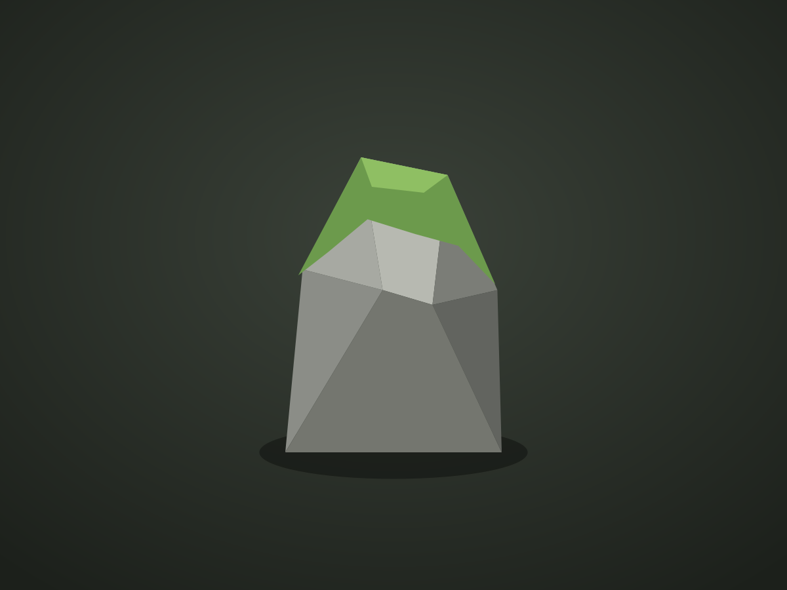
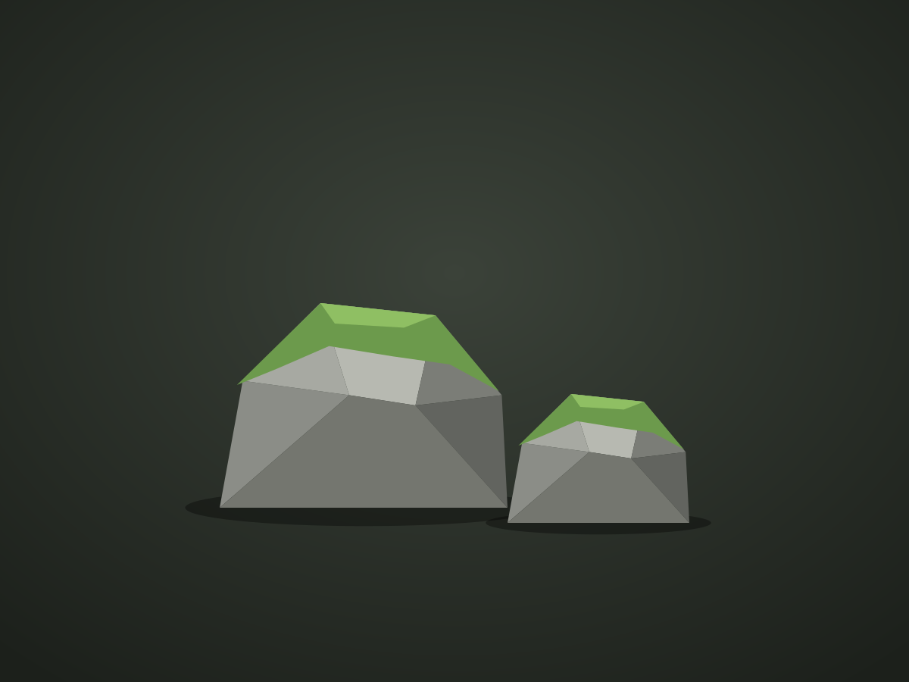

A short intro to what you made and why. The rock kit had to cover the whole valley with as few unique meshes as possible.

<Gallery cols={3} caption="Three of the twelve rock variants.">
  
  
  
</Gallery>

## Breakdown

- **Modelling:** blocked out in Maya, sculpted and decimated in Blender.
- **Materials:** one tiling rock material with a world-space moss blend, so every rock gets moss on top automatically.
- **Budget:** 800–2,000 triangles per rock, with two LODs each.

## What I learned

Write a few honest lines about what worked and what you'd do differently. People reviewing portfolios read this part.
